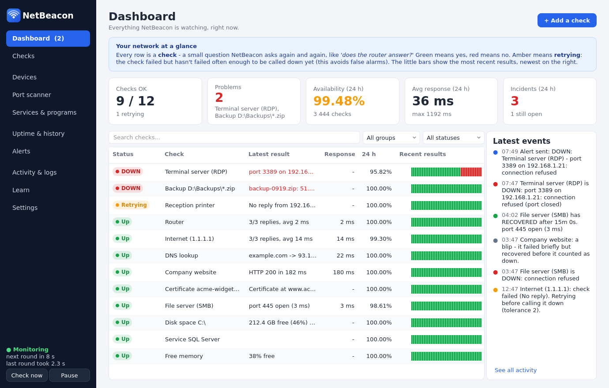
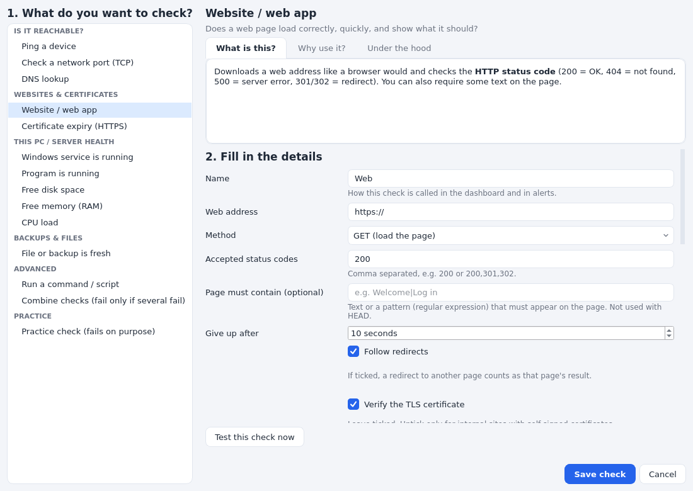
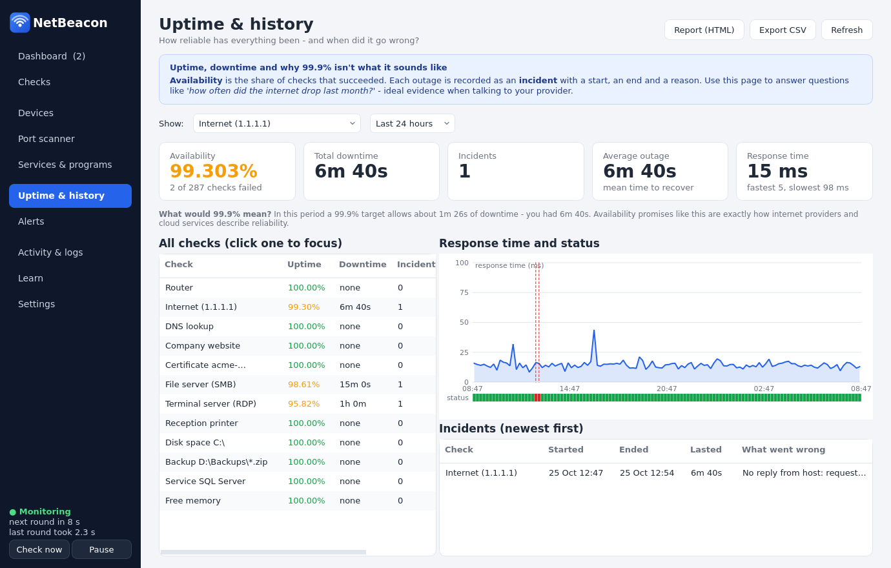
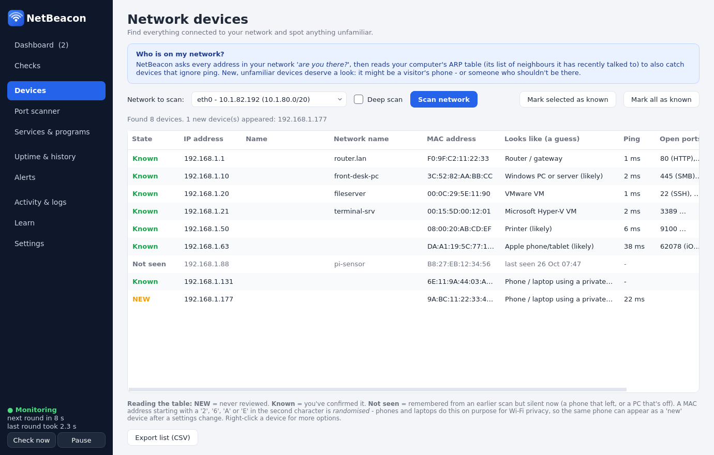
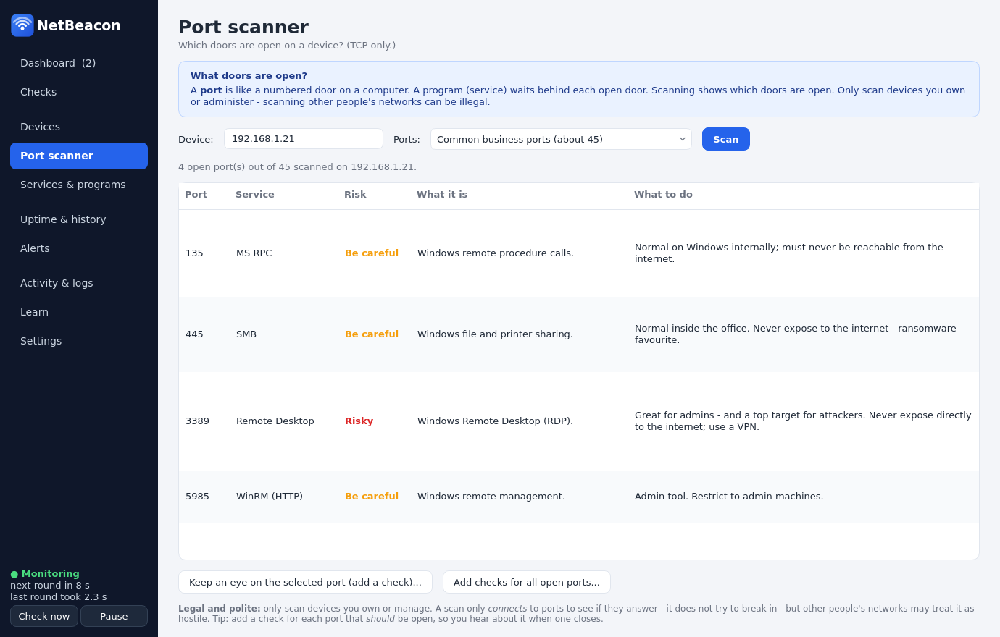

# NetBeacon

**A friendly, teaching-first network monitor for small businesses - a Windows desktop app built on [SimpleMonitor](https://simplemonitor.readthedocs.io/).**

NetBeacon watches the things your business can't live without (router, internet, servers, websites, backups, disks...), tells you
when something breaks - and when it recovers - keeps the history, and **explains every concept as you go**, so that when you
outgrow it you already speak the language of Zabbix, PRTG, Checkmk and friends.



| | |
|---|---|
|  |  |
|  |  |

## Features

| You asked for | In NetBeacon |
|---|---|
| Host ping | **Ping** check: several packets, latency, packet-loss limit, optional "too slow" limit. Works with any Windows language. |
| Open ports (TCP) | **TCP port** check + a **Port scanner** page that explains every open port and flags risky ones (Telnet, RDP, exposed databases...). |
| Available network devices | **Devices** page: ping sweep + ARP table + reverse DNS, optional deep scan, "looks like" guesses, name your devices, **NEW device** detection and background **watch for newcomers**. |
| Running services | **Services & programs** page: Windows services, running programs and listening ports of this PC - one click turns any of them into a check. |
| Uptime and downtime | **Uptime & history** page: availability %, downtime, incidents (start, end, reason), MTTR, response-time chart, SLA explainer, CSV export and a shareable **HTML report**. |
| ...and more | Website checks (status code, text match, speed), **TLS certificate expiry**, DNS (system resolver or a specific server), disk space, memory, CPU, **backup freshness**, run-any-command, combined (compound) checks, a **practice check that fails on purpose**. |
| Teaching | Every page has a hint box, every field has help text, each check type has *What is this / Why use it / Under the hood* tabs, a 15-lesson **Learn** section with glossary, guided practice, and a **"graduation guide"** to bigger tools. Switch it all off in *Settings* when you no longer need it. |
| Alerts | Desktop pop-up, email (SMTP), Slack, Telegram, ntfy, Pushover - with *test* buttons, tolerance, repeat, recovery messages, quiet hours. |
| **What's wrong?** (new in 1.1) | One button (Dashboard, sidebar, tray, or right-click a check) tests the chain *this PC -> Wi-Fi -> router -> internet -> DNS -> web -> the check* and says in one sentence where it breaks, what to do, and what it ruled out. Copy the report for your IT person or provider. |
| **Network map** (new) | Router in the middle, every known device around it, coloured by its checks (or NEW / not monitored / not seen). Click a device to monitor it, scan its ports, name it or wake it. |
| **Internet speed** (new) | Scheduled speed tests (latency, jitter, download, upload) with history, a chart against the speed you pay for, CSV export and a capped data budget. |
| **Wi-Fi health** (new) | Signal (% and dBm), band, channel, link speed and access point from Windows' `netsh`; signal history; nearby networks; 2.4 GHz channel crowding; plain-English advice; a *Wi-Fi signal* check type. |
| **Weekly summary** (new) | Every week, the history turned into sentences: internet drops, outages, flapping, a disk-full forecast, backups, certificates, speed vs. plan, Wi-Fi, new devices. Pop-up, saved copy, optional email. |
| **Unknown devices + Wake-on-LAN** (new) | New-device alerts can now go to every alert channel (email, Slack, Telegram, ntfy, Pushover), and any device with a known MAC can be woken with a magic packet. |
| Smarter Quick Start (new) | The wizard can also scan for printers, storage and servers and suggest checks for them, and offers device watching, speed tests, Wi-Fi watching and the weekly summary. |
| GUI + Windows `.exe` | PySide6 (Qt) interface, light/dark theme, system-tray app, start with Windows. Built into a single `NetBeacon.exe` by the included GitHub workflow. |

### SimpleMonitor features NetBeacon turns into friendly controls

| SimpleMonitor concept | In the NetBeacon UI |
|---|---|
| `tolerance` | **Forgive N extra failed checks** - with a live sentence telling you how many seconds that means |
| `depend` | **Depends on** - one alert about the router instead of 20 about everything behind it |
| `gap` | **Check this: every minute / 5 minutes / hour / day** |
| `group`, `urgent`, `notify` | Group, urgent, send-alerts options |
| `remind` | **Remind me every N minutes** |
| `failure_doc` | **What to do if this fails** (a runbook line that is included in alerts) |
| `recover_command` | **Self-healing command** (advanced) |
| `compound` | **Combine checks** ("alarm only if both internet lines are down") |
| `tls_expiry`, `filestat`, `diskspace`, `memory`, `process`, `service`, `command`, `fail` | Matching check types |
| Alerters: `email`, `slack`, `telegram`, `ntfy`, `pushover` + alert times / days / limit / repeat / catch-up | The **Alerts** page |
| `html` logger | **Status web page** option in Settings |
| Config files | **Activity > Config files** shows the exact `monitor.ini`/`monitors.ini`; **Settings > Export for stock SimpleMonitor** writes files that run on plain `pip install simplemonitor` |

## Why SimpleMonitor? (and why not something else)

You asked for a recommendation, so here is the reasoning:

* **SimpleMonitor** is small, pure Python, BSD-licensed, configured with two tiny INI files, and has exactly the concepts a beginner needs
  (check, tolerance, dependency, alerter, logger) - which are also the concepts of every big tool. It runs on Windows, and it is *meant to be extended*.
* **Alternatives considered:** Uptime Kuma (great, but a Node.js web service - not a desktop app and not embeddable), Zabbix / Checkmk / PRTG / LibreNMS
  (excellent, but exactly the "complex tools" this app is meant to prepare people for), Nagios (config-heavy), Prometheus (metrics database, not an uptime tool).
* **Verdict:** SimpleMonitor is the right engine for this goal. NetBeacon embeds it as a library - it is the real engine in the running app, not decoration.

A few gaps in SimpleMonitor's stock monitors on Windows are filled with NetBeacon extensions registered through SimpleMonitor's own `@register` plug-in mechanism
(see `netbeacon/sm_ext.py` - it is also a short, readable example of "how to add your own check"): `lan_ping` (the stock `host` monitor only parses English output and
never reports latency), `lan_dns` (the stock `dns` monitor needs the Linux tool `dig`), timing-aware `lan_tcp` / `lan_http`, and Windows-friendly disk, CPU, file and command checks.
The *Export* feature maps them back to stock monitors where an equivalent exists.

## Get the Windows .exe (GitHub Actions)

1. Create a new GitHub repository and upload this whole folder (keep the `.github/workflows/build.yml` path exactly).
2. Push to `main`. The **Build NetBeacon for Windows** workflow starts by itself (see the *Actions* tab). It
   installs everything, runs the tests, builds the `.exe`, **launches the finished `.exe` with `--selftest`** (real engine + every screen) and uploads it.
3. When the run is green, get the files in **either** place:
   * **Releases** (right-hand side of the repository page) -> **Latest build** -> `NetBeacon.exe` (single file) or `NetBeacon-folder.zip` (unzip, run `NetBeacon\NetBeacon.exe`).
   * *Actions* -> click the run -> scroll to the bottom of the Summary page -> **Artifacts** -> `NetBeacon-windows`.
4. Want a numbered release? Tag it: `git tag v1.0.0 && git push origin v1.0.0` - the workflow publishes it under *Releases*.

You can also start a build by hand: *Actions -> Build NetBeacon for Windows -> Run workflow*.

**First launch on Windows:** the exe is not code-signed, so SmartScreen may say *"Windows protected your PC"* -> **More info -> Run anyway**.
Single-file PyInstaller programs are also sometimes flagged by antivirus; the folder version (`NetBeacon-folder.zip`) starts faster and is flagged less often.
If a company needs it silent, sign the exe with your own certificate.

## Run from source (any OS with Python 3.12+)

```bash
python -m venv .venv && . .venv/bin/activate        # Windows: .venv\Scripts\activate
pip install -r requirements-dev.txt
pip install --no-deps simplemonitor==1.15.0          # engine; --no-deps skips ~10 libraries NetBeacon doesn't use
python -m netbeacon                                  # or: python run_netbeacon.py
python -m pytest                                     # tests (GUI tests run off-screen)
python -m netbeacon --selftest result.json           # quick health check of an install
```

Build the exe yourself on Windows: `pyinstaller --noconfirm --clean netbeacon.spec` (one file) or
`set NB_ONEDIR=1 && pyinstaller --noconfirm --clean netbeacon.spec` (folder).

## Where things are stored

`%APPDATA%\NetBeacon\` - `settings.json`, `monitors.json`, `history.sqlite3`, `simplemonitor-config\` (the generated INI files), `logs\`, `status-page\`.
Set the `NETBEACON_HOME` environment variable to use a different folder. Nothing is sent anywhere except the alerts you configure.

## Project layout

```
netbeacon/
  compat.py         start-up shims (stand-ins for SimpleMonitor's unused heavy deps, no console flashes, ...)
  sm_ext.py         NetBeacon's SimpleMonitor extensions: custom checks + GuiLogger + DesktopAlerter
  checks.py         catalogue of check types: form fields, help text, INI mapping, export mapping
  config_writer.py  Store -> monitor.ini / monitors.ini (validates every check and channel first)
  engine.py         runs SimpleMonitor on a background thread, records incidents/events, snapshots for the GUI
  store.py          settings + checks (JSON) and history (SQLite)
  netutil.py        ping, TCP, DNS client, ARP, network scan, port scan, services
  knowledge.py      all teaching content (tips, glossary, lessons, port explanations)
  diagnose.py       'What's wrong?' - step-by-step root-cause diagnosis (no Qt, probes are swappable for tests)
  speedtest.py      latency / download / upload test against a configurable server
  wifi.py           reads and explains `netsh wlan` output (signal, channel, neighbours, advice)
  digest.py         the weekly plain-English summary, incl. the disk-full forecast and the schedule
  notify.py         one-off messages through every alert channel + formatted email
  devices.py reports.py selftest.py app.py
  ui/               PySide6 interface (main window, pages, check dialog, wizard, theme)
tests/              pytest: engine end-to-end with local servers, GUI tests off-screen
tools/              make_icon.py (writes the .ico), demo_shots.py (renders every screen with demo data)
netbeacon.spec      PyInstaller recipe        .github/workflows/build-windows.yml   the build
```

More: [User guide](docs/USER_GUIDE.md) - [Architecture & extending](docs/ARCHITECTURE.md)

## Honest limitations

* Active ("polling") monitoring only: no SNMP, agents, flow data or log collection (the Learn section explains when you need them).
* Service/process/disk/CPU/memory checks look at **the computer NetBeacon runs on**. To watch other servers, check their ports/web pages/DNS, or run SimpleMonitor on them
  and forward results to a central instance (a SimpleMonitor feature - see its docs).
* Monitoring only happens while NetBeacon runs (tray icon + *start with Windows* are provided). For 24/7 headless monitoring use *Export for stock SimpleMonitor* on an always-on machine.
* Passwords/tokens for alert channels are stored unencrypted in your user profile. Use app passwords or tokens.
* The speed test's default server is Cloudflare's public speed-test service (`/__down` and `/__up`). You can point it at any server that answers those two addresses. Results from Wi-Fi PCs mostly measure the Wi-Fi.
* Wi-Fi details come from Windows' `netsh wlan`. On recent Windows 11 builds, listing *nearby* networks needs location permission for desktop apps; NetBeacon says so when Windows refuses.
* Wake-on-LAN must be enabled in the target PC's BIOS/UEFI and adapter settings, and usually only works inside the same network.
* New-device and weekly-summary messages ignore quiet hours (they are one-off messages, not check alerts).
* Port and device scans use ordinary connections and ping - no raw packets, no admin rights - which keeps them safe but less thorough than nmap. Scan only networks you are allowed to scan.

## Licence

MIT for NetBeacon. SimpleMonitor is BSD 3-Clause (c) James Seward; PySide6/Qt is LGPL v3.
